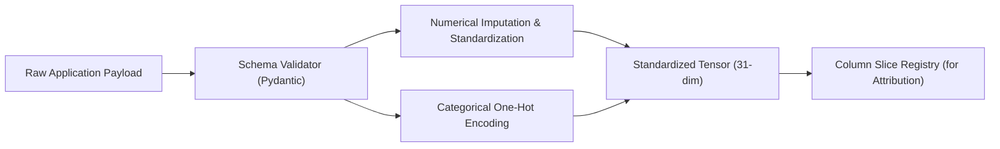

# AppGuard AI: Insurance Application Dataset Preparation Report
**Deliverable 1 — Educational Project Documentation**  
**System:** AppGuard AI: Insurance Application Fraud Detector  
**Author / Date:** DeepMind Agentic Systems / November 2026  
**Status:** Complete & Verified  

---

## 1. Executive Summary & Regulatory Scope

The AppGuard AI platform provides an unsupervised anomaly detection mechanism designed to triage new personal and commercial insurance applications for operational human underwriting review. The core modeling objective is to learn the multidimensional manifold of *typical, nominal insurance applications* and flag statistically atypical submissions that deviate markedly from expected patterns.

### Operational & Governance Boundaries
- **Advisory Review Signal Only:** Anomaly scores quantify statistical atypicality relative to nominal baseline distributions. High anomaly scores do **not** constitute legal or factual proof of insurance fraud, misrepresentation, or dishonesty.
- **Operational Triage & Adverse Action Boundaries:** In real-world insurance underwriting, applicable legal, regulatory, and adverse-action requirements vary significantly by jurisdiction, product line, and intended operational use; any real deployment would require formal review by qualified legal and insurance compliance professionals. In this system, anomaly scores function solely as operational prioritization signals to support human review, and must never be used for automated approval, denial, pricing, cancellation, or other adverse actions. This educational demonstration does not provide legal or regulatory advice.
- **Exclusion of Protected Attributes & Direct Identifiers:** In compliance with privacy principles and non-discrimination guidelines, the modeling pipeline strictly excludes names, government identification numbers (Social Security Numbers, Tax IDs, passport numbers), full dates of birth, street-level addresses, ZIP codes (which can act as geographic proxies for race or socioeconomic status), and protected demographic traits (race, color, religion, sex, marital status, sexual orientation, disability status).

---

## 2. Dataset Schema & Feature Dictionary

The AppGuard illustrative schema captures operational, transactional, and policy-structural characteristics across personal and commercial property/casualty and life lines:

| Field Name | Type | Constraints / Allowed Values | Feature Role | Justification & Underwriting Rationale |
| :--- | :--- | :--- | :--- | :--- |
| `policy_type` | Categorical | `auto`, `homeowners`, `term_life`, `renters`, `commercial_property` | Model Feature (One-Hot) | Defines core underwriting category, liability limits, and baseline risk profile. |
| `coverage_amount` | Numerical (USD) | $> 0$ and $\le \$10,000,000$ | Model Feature (Standardized) | Monetary limit of liability requested; strongly correlated with asset value and income. |
| `deductible_amount` | Numerical (USD) | $\ge 0$ and $\le \$100,000$ | Model Feature (Standardized) | Out-of-pocket threshold selected; unusual pairing with coverage is a known risk indicator. |
| `premium_frequency` | Categorical | `monthly`, `quarterly`, `semi_annual`, `annual` | Model Feature (One-Hot) | Premium installment schedule; cash-flow and payment structuring indicator. |
| `application_channel`| Categorical | `online_direct`, `independent_broker`, `captive_agent`, `aggregator_partner`, `mobile_app` | Model Feature (One-Hot) | Origination touchpoint; distribution channels exhibit distinct baseline distributions. |
| `applicant_age` | Numerical (Years)| $\ge 18$ and $\le 105$ | Model Feature (Standardized) | Adult age in years (binned/continuous, no birth date); lifecycle underwriting factor. |
| `annual_income_estimate`| Numerical (USD)| $\ge 0$ and $\le \$5,000,000$ | Model Feature (Standardized) | Stated gross annual income; baseline benchmark against coverage limits. |
| `prior_application_count`| Numerical | $\ge 0$ and $\le 50$ (past 36 months) | Model Feature (Standardized) | Velocity indicator measuring submission frequency across carriers. |
| `recent_address_changes_count`| Numerical | $\ge 0$ and $\le 20$ (past 24 months) | Model Feature (Standardized) | Residential stability metric; frequent address changes correlate with underwriting complexity. |
| `property_or_vehicle_age`| Numerical (Years)| $\ge 0$ and $\le 100$ | Model Feature (Standardized) | Age of insured structure or vehicle; impacts replacement cost and insurable value. |
| `beneficiary_relation`| Categorical | `self`, `spouse`, `child`, `parent`, `business_partner`, `other` | Model Feature (One-Hot) | Insurable interest indicator; non-standard designations warrant manual verification. |
| `declared_credit_tier`| Categorical | `excellent`, `good`, `fair`, `limited_history` | Model Feature (One-Hot) | Broad credit tier (self-declared risk tiering indicator; not an external consumer report). |
| `application_id` | Identifier | String (e.g. `APP-TRN-00001`) | Metadata Only | Tracking key for audit logs and workbench triage; **excluded from model inputs**. |

---

## 3. Data Source & Synthetic Generation Methodology

### Why Synthetic Data?
1. **Privacy & Policyholder Protection:** Real-world insurance application databases contain sensitive Non-Public Personal Information (NPI) subject to statutory data protection frameworks. Transmitting, hosting, or storing real policyholder records for academic or demonstration purposes introduces privacy and re-identification risks.
2. **Ground-Truth Calibration Control:** Real-world insurance claims and application databases suffer from severe label noise, reporting lag, and unobserved fraud (the "silent fraud" problem where deceptive applications are never caught). Synthetic modeling enables controlled generation of strictly nominal baselines alongside documented archetypal anomalies.
3. **Synthetic Demonstration Disclaimer:** All performance metrics reported in this project reflect synthetic benchmark data generated deterministically for educational demonstration purposes. **These results must not be misrepresented as verified real-world underwriting outcomes or claim fraud detection rates.** Evaluation on synthetic distributions does not establish real-world fraud detection performance.

### Multivariate Synthetic Generation Engine
The data generation engine (`appguard/data_generator.py`) employs a deterministic NumPy random number generator (`np.random.default_rng(seed=42)`) to generate 6,000 nominal records and 200 synthetic anomalies across three splits:
- **Training Set (`insurance_applications_train.csv`):** 5,000 records containing **100% nominal applications**, modeling baseline multi-feature correlations (e.g., auto policy coverages ranging from \$25k–\$500k with proportional deductibles and incomes; life coverages aligned with annual salary multiples).
- **Validation / Calibration Set (`insurance_applications_val.csv`):** 1,000 records containing **100% nominal applications** held out entirely from training, used solely for empirical quantile threshold calibration.
- **Evaluation Test Set (`insurance_applications_test.csv`):** 1,000 records comprising 800 synthetic nominal applications and 200 synthetic atypical archetypes whose labels are assigned by the data generator. Used to measure internal consistency of the model's reconstruction-error threshold on the synthetic distributions; this does not validate real-world triage efficacy.

### Synthetic Anomaly Archetypes
1. **Income-to-Coverage Disproportionality:** Term life submissions requesting \$1.5M–\$3M coverage where declared income is below \$24,000/year and the beneficiary is listed as "other".
2. **Application Velocity Spikes:** Submissions recording 7–18 prior applications across carriers in the prior 36 months paired with 5–12 residential address transitions in 24 months.
3. **Channel-Product Incongruity:** Commercial property policies requesting \$4.5M coverage with unusually low deductibles (\$250) submitted via unassisted consumer mobile applications.
4. **Zero Deductible High-Limit Submissions:** Maximum limit homeowners coverages with \$0 deductibles and monthly payment frequencies.
5. **Youth Commercial Extreme:** Commercial property policies listing an 18-year-old applicant with minimal stated earnings.

---

## 4. Preprocessing Pipeline & Engineering Nuances

The tabular preprocessing pipeline (`appguard/preprocessor.py`) transforms raw heterogenous application dictionaries into standardized numeric tensors suitable for neural autoencoders:

### Key Technical Implementations
1. **Numerical Standardization:**
   $$\tilde{x}_i = \frac{x_i - \mu_i}{\sigma_i}$$
   For each numerical feature $i$, the sample mean $\mu_i$ and standard deviation $\sigma_i$ are fitted exclusively on the nominal training set. Numerical missing values are imputed using the empirical training median.
2. **Categorical One-Hot Encoding & Safe Zero-Vector Fallback:**
   Categorical features are mapped into binary indicator vectors across known categories. If an incoming application presents an unknown category (e.g., an unrecognized channel or policy subtype), the preprocessor assigns an all-zeros vector across that categorical slice. This prevents runtime crashes, guarantees graceful degradation, and naturally flags the unknown category as statistically atypical during reconstruction.
3. **Attribution Slice Tracking:**
   The preprocessor maintains an internal `ColumnSlice` registry recording the starting and ending indices of each feature in the 31-dimensional encoded vector. This allows the scoring engine to isolate the reconstruction error of individual features and decode normalized values back to original dollars, years, or categories for operational explainability.

---

## 5. Dataset Quality Assurance & Limitations

### Quality Verification Checks
- **Null Value Tolerance:** Tested with simulated missing inputs (`tests/test_preprocessing.py`), verifying robust median and mode fallback without numeric overflow.
- **Dimensional Stability:** Fixed 31-dimensional tensor output across all training, validation, and inference scenarios.
- **No Data Leakage:** Scalers and encoders are fitted strictly on `train_df`. Validation and test sets are transformed using frozen parameters.

### Inherent Limitations & Operational Caveats
1. **Calibration Data Contamination:** If the baseline dataset used for calibration contains unflagged or undetected fraud, the empirical threshold will shift upwards, causing the model to absorb atypical fraud patterns as "normal."
2. **False Positives on Legitimate Niche Cases:** Legitimate policyholders with non-standard needs (e.g., high-net-worth individuals, recent relocations, or unique commercial structures) will naturally generate elevated anomaly scores. Human underwriter discretion is indispensable.
3. **False Negatives on Typical-Looking Fraud:** Deceptive applications crafted to mimic standard distributions will yield low reconstruction errors and pass standard routing. Anomaly detection is a complementary defense layer, not a replacement for credit checks, title searches, or claims history verification.
