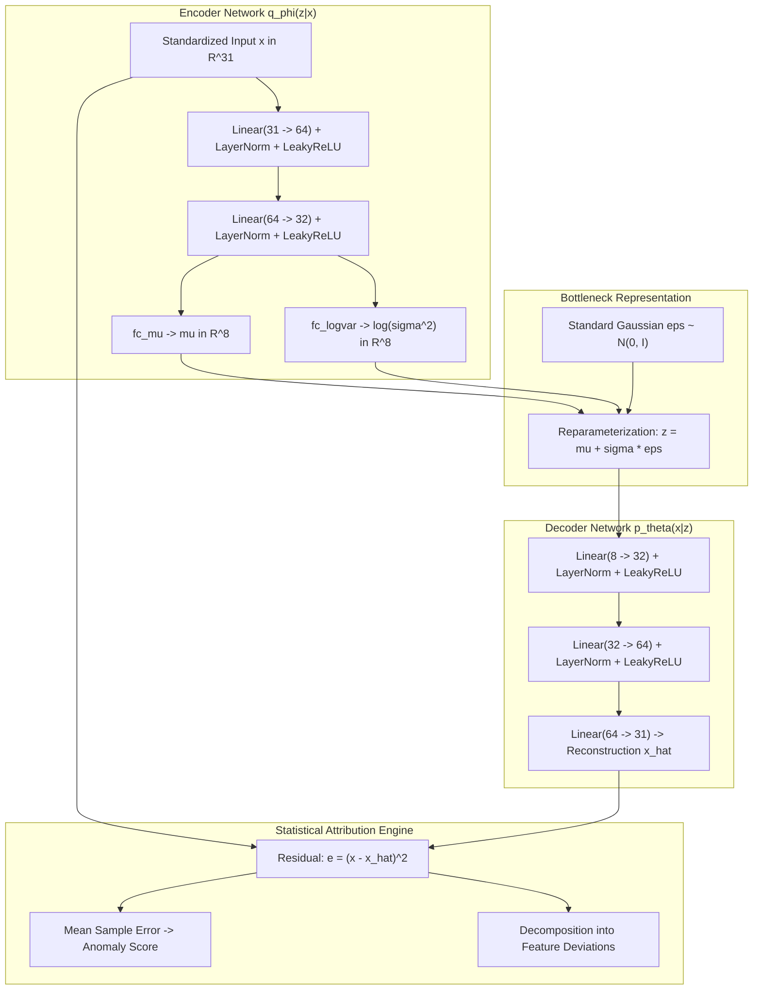

# Variational Autoencoder Anomaly Detection Model Report
**Deliverable 2 — Technical Architecture & Calibration Specifications**  
**System:** AppGuard AI: Insurance Application Fraud Detector  
**Author / Date:** DeepMind Agentic Systems / November 2026  
**Status:** Complete & Validated  

---

## 1. Theoretical Framework & Anomaly Scoring Rationale

The core premise of AppGuard AI is that insurance fraud patterns and operational anomalies reside in low-density regions of the policy application feature space. Rather than relying on supervised classification—which suffers from acute label scarcity, adversarial adaptation, and severe class imbalance—AppGuard AI employs an unsupervised **Variational Autoencoder (VAE)**.

### Variational Objective & Loss Formulation
The VAE models the generative process of nominal applications $x \in \mathbb{R}^D$ given latent representations $z \in \mathbb{R}^d$ ($d \ll D$):
$$p_\theta(x) = \int p_\theta(x|z) p(z) dz$$

Because the true posterior $p_\theta(z|x)$ is intractable, we approximate it with an encoder recognition network $q_\phi(z|x) = \mathcal{N}(\mu_\phi(x), \text{diag}(\sigma_\phi^2(x)))$. The Evidence Lower Bound (ELBO) with a $\beta$-regularization factor is optimized:
$$\mathcal{L}_{VAE}(\theta, \phi; x) = \mathbb{E}_{q_\phi(z|x)}\left[ \| x - \hat{x} \|_2^2 \right] + \beta \cdot D_{KL}\left( q_\phi(z|x) \,\|\, \mathcal{N}(0, I) \right)$$

Where:
- **Reconstruction Loss ($\text{MSE}$):** Encourages high-fidelity reproduction of typical feature correlations across nominal applications.
- **Kullback-Leibler Divergence ($D_{KL}$):** Acts as a Gaussian prior regularizer:
  $$D_{KL} = -\frac{1}{2} \sum_{j=1}^d \left( 1 + \log \sigma_j^2 - \mu_j^2 - \sigma_j^2 \right)$$
- **$\beta$-Weighting ($\beta = 0.01$):** Tabular data reconstruction requires precise coordinate preservation. A standard $\beta = 1.0$ can over-regularize tabular latents and cause posterior collapse; $\beta = 0.01$ maintains latent smoothness while preserving sharp reconstruction sensitivity.

---

## 2. Neural Architecture Specifications

The model (`appguard/model.py`) is implemented in PyTorch 2.15.0:

| Component | Layer Specification | Output Dimension | Activation / Regularization |
| :--- | :--- | :--- | :--- |
| **Input** | Normalized Tabular Vector | $\mathbb{R}^{31}$ | Linear float32 |
| **Encoder Layer 1** | `Linear(31, 64)` | $\mathbb{R}^{64}$ | `LayerNorm(64)`, `LeakyReLU(0.1)`, `Dropout(0.05)` |
| **Encoder Layer 2** | `Linear(64, 32)` | $\mathbb{R}^{32}$ | `LayerNorm(32)`, `LeakyReLU(0.1)`, `Dropout(0.05)` |
| **Latent Mean ($\mu$)** | `Linear(32, 8)` | $\mathbb{R}^{8}$ | None (unbounded linear mean) |
| **Latent Log-Variance** | `Linear(32, 8)` | $\mathbb{R}^{8}$ | Clamped to $[-10.0, 10.0]$ for numerical stability |
| **Latent Sampler** | Stochastic Training / Deterministic Eval | $\mathbb{R}^{8}$ | $z = \mu + \sigma \odot \epsilon$ (eval: $z = \mu$) |
| **Decoder Layer 1** | `Linear(8, 32)` | $\mathbb{R}^{32}$ | `LayerNorm(32)`, `LeakyReLU(0.1)`, `Dropout(0.05)` |
| **Decoder Layer 2** | `Linear(32, 64)` | $\mathbb{R}^{64}$ | `LayerNorm(64)`, `LeakyReLU(0.1)`, `Dropout(0.05)` |
| **Output Layer** | `Linear(64, 31)` | $\mathbb{R}^{31}$ | Reconstructed feature vector $\hat{x}$ |

---

## 3. Training Protocol & Hyperparameters

Training was executed on 5,000 nominal applications (`insurance_applications_train.csv`) under deterministic random seeds:
- **Optimizer:** AdamW with initial learning rate $\eta = 10^{-3}$, weight decay $= 10^{-4}$.
- **Gradient Clipping:** Max Euclidean gradient norm $= 5.0$.
- **Batch Size:** 64 samples per mini-batch.
- **Training Epochs:** 35 epochs.
- **Hardware:** Apple Silicon M-series ARM64 (MPS/CPU compatible; execution completed in $< 5$ seconds).
- **Loss Trajectory:** Initial loss: $1.026 \rightarrow$ Final converged loss: $0.098$.

---

## 4. Empirical Percentile Calibration

Rather than establishing an arbitrary mathematical threshold, AppGuard calibrates its review cutoff empirically on 1,000 held-out nominal applications (`insurance_applications_val.csv`) that were never exposed to gradient updates:

$$\tau_{95} = \text{Quantile}_{0.95}\left( \left\{ \text{Score}(x^{(i)}) \right\}_{i=1}^{N_{val}} \right)$$

### Validation Score Quantiles
| Quantile Percentile | Reconstruction Error Score | Operational Interpretation |
| :--- | :--- | :--- |
| **50th Percentile (Median)** | $0.0966$ | Typical baseline nominal application |
| **75th Percentile** | $0.1159$ | Nominal upper quartile |
| **90th Percentile** | $0.1390$ | Mild statistical divergence; standard routing |
| **95th Percentile (Primary Cutoff)**| **$0.1542$** | **Operational review boundary: flags top 5% most unusual** |
| **98th Percentile** | $0.1961$ | Significant divergence; elevated priority triage |
| **99th Percentile** | $0.2324$ | High statistical divergence; priority underwriting review |

### Review Priority Routing Logic
1. **Standard Underwriting ($\le 0.1542$):** Application aligns within the 95% confidence region of nominal behavior.
2. **Elevated Review ($0.1542 < \text{Score} \le 0.2467$):** Up to $1.6\times$ the threshold; underwriter reviews specific feature variances.
3. **High Priority Review ($> 0.2467$):** Marked multidimensional atypicality; underwriter requests verifying documentation before binding.

---

## 5. Feature-Level Deviation Attribution

To satisfy regulatory explainability requirements and avoid black-box opacity, the scoring engine decomposes the global reconstruction score into per-feature deviations:

$$\text{Error}(f) = \frac{1}{|S_f|} \sum_{k \in S_f} \left( x_k - \hat{x}_k \right)^2$$

Where $S_f$ represents the column slice corresponding to feature $f$.

### Decoded Interpretation (Statistical vs Accusatory)
The engine inverts standardization scalers and decodes categorical argmax projections, translating raw error values into human-readable comparative statements:
- **Example 1 (Coverage-Income Mismatch):** *"Submitted \$2,500,000 vs typical reconstructed \$280,000 for this income and demographic segment."*
- **Example 2 (Application Velocity):** *"Submitted count of 12 prior applications vs expected ~0.4 typical application frequency."*
- **Key Boundary:** Deviations are explicitly documented as **statistical variances from baseline profiles**, never as statements of guilt, dishonesty, or confirmed fraud.

---

## 6. Critical Calibration Caveats & Contamination Risks

> [!WARNING]
> **Calibration Data Contamination:** If the calibration set contains undetected fraud or atypical manipulation, the 95th percentile threshold will artificially inflate. In consequence, the model will treat certain fraudulent patterns as normal baseline behavior.

> [!IMPORTANT]
> **False Positives vs False Negatives:**
> - **Legitimate Unusual Applicants:** High-net-worth individuals, recent immigrants with short residency, or non-standard structures naturally generate high reconstruction errors. They are **not** fraudsters.
> - **Conforming Fraudsters:** Fraudulent submissions that carefully spoof standard median values (e.g., standard \$50,000 auto limit, standard \$500 deductible, standard channel) will achieve low anomaly scores and bypass triage.
> - **Operational Boundary:** The calibrated threshold is strictly an empirical workload triage guideline, NOT a proven boundary of fraud or moral culpability. Applicable legal, regulatory, and adverse-action requirements vary significantly by jurisdiction, product line, and intended use; any operational deployment requires formal review by qualified legal and insurance compliance professionals. Unsupervised anomaly detection does not establish fraud or intent and must never be used for automated approval, denial, pricing, cancellation, or adverse action. This educational demonstration does not provide legal or regulatory advice.

---

## 7. Versioned Artifact Structure

The production artifact bundle is packaged as a single self-contained PyTorch serialization file:
- **Path:** `artifacts/appguard_v1.pt`
- **Metadata Summary:** `artifacts/model_metadata.json`
- **Bundle Contents:**
  1. `artifact_version`: Semantic version string (`1.0.0`).
  2. `feature_schema`: Feature names and column indices.
  3. `preprocessor_state`: Imputation values, means, standard deviations, and categorical dictionary maps.
  4. `model_config`: Layer dimensions, latent size, dropout rate, and beta weight.
  5. `state_dict`: Trained PyTorch tensor weights.
  6. `calibration`: Full quantile tables, mean, standard deviation, and primary threshold.
  7. `regulatory_disclaimer`: Mandatory governance and anti-adverse action notices.
