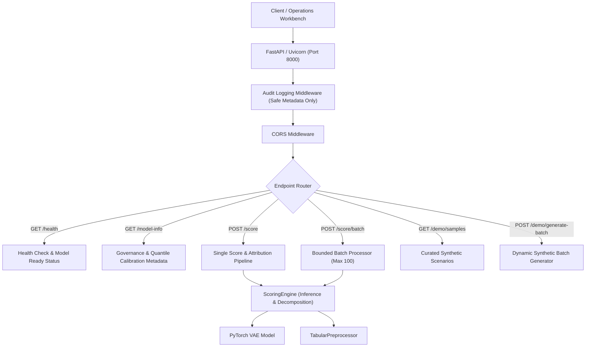

# AppGuard AI: Insurance Application Fraud Detection API
**Deliverable 3 — Service Implementation, Governance, & API Reference**  
**System:** AppGuard AI: Insurance Application Fraud Detector  
**Author / Date:** DeepMind Agentic Systems / November 2026  
**Status:** Production Ready & Automated Test Verified  

---

## 1. Architectural Overview & Design Principles

The AppGuard AI scoring service is implemented in **FastAPI** (v0.165.0) on Python 3.14 with an asynchronous ASGI architecture powered by **Uvicorn**. The API serves as the production inference layer, loading the versioned PyTorch VAE artifact bundle (`artifacts/appguard_v1.pt`) during application lifespan startup and exposing high-throughput REST endpoints.



### Key Engineering Principles
1. **Zero PII Logging & Secure Telemetry:** The audit logging middleware captures exclusively HTTP method, URI path, response status code, and execution latency. Raw request payloads, applicant identifiers, and submission values are **never logged**, preventing data leakage to log aggregators.
2. **Safe Per-Record Error Isolation:** In batch scoring requests, a malformed or invalid application record does not abort the entire request. The system safely returns an isolated error message for the offending record index while successfully scoring all valid records.
3. **Strict Input Boundaries:** Input payloads are validated via Pydantic models with field constraints (e.g., adult age $\ge 18$, positive coverage limits $\le \$10,000,000$, and validated categorical enumeration). Requests exceeding the maximum batch threshold ($> 100$ records) are rejected with HTTP 422.
4. **Persistent Governance Notice:** Every scoring response—both single and batch—explicitly returns a mandatory regulatory advisory reminding operators that scores are advisory review signals and that automated adverse decisions are prohibited.

---

## 2. API Endpoints Specification

### 2.1 System Health: `GET /api/v1/health`
Reports service health, active uptime, and model artifact load status.

**Response Example:**
```json
{
  "status": "healthy",
  "service": "AppGuard AI Fraud Detector",
  "version": "1.0.0",
  "model_loaded": true,
  "uptime_seconds": 142.5,
  "timestamp_utc": "2026-11-22T09:15:30.124567+00:00"
}
```

---

### 2.2 Model & Governance Info: `GET /api/v1/model-info`
Provides transparent access to architecture parameters, input dimensionality, and empirical percentile calibration cutoffs.

**Response Example:**
```json
{
  "artifact_version": "1.0.0",
  "model_architecture": "TabularVAE",
  "created_at_utc": "2026-11-22T09:01:50.016740+00:00",
  "calibrated_threshold": 0.15416,
  "target_percentile": 95.0,
  "input_dimension": 31,
  "latent_dimension": 8,
  "hidden_dims": [64, 32],
  "regulatory_boundary": "Anomaly detection scores represent statistical distance from nominal application profiles. They do NOT establish fraud, dishonesty, or elevated claim probability. Applicable legal and regulatory requirements vary by jurisdiction and use case; real-world deployments require review by qualified legal and compliance professionals. Within this system, scores are triage signals only and must not be used for automated approval, denial, pricing, cancellation, or other adverse decisions.",
  "synthetic_disclaimer": "Educational demo model trained on synthetic policy applications. Synthetic performance metrics must not be misrepresented as real-world underwriting outcomes."
}
```

---

### 2.3 Single Application Scoring: `POST /api/v1/score`
Scores an individual application, evaluates it against the calibrated threshold, and attributes statistical deviations back to individual input features.

**Request Payload:**
```json
{
  "application_id": "APP-EXP-001",
  "policy_type": "term_life",
  "coverage_amount": 2500000.0,
  "deductible_amount": 0.0,
  "premium_frequency": "monthly",
  "application_channel": "online_direct",
  "applicant_age": 22.0,
  "annual_income_estimate": 19000.0,
  "prior_application_count": 0.0,
  "recent_address_changes_count": 1.0,
  "property_or_vehicle_age": 0.0,
  "beneficiary_relation": "other",
  "declared_credit_tier": "limited_history"
}
```

**Response Example:**
```json
{
  "status": "success",
  "application_id": "APP-EXP-001",
  "anomaly_score": 0.20331,
  "calibrated_threshold": 0.15416,
  "review_recommended": true,
  "review_priority": "elevated",
  "top_deviations": [
    {
      "feature_name": "annual_income_estimate",
      "feature_type": "numerical",
      "submitted_value": 19000.0,
      "reconstructed_value": 97927.0,
      "reconstruction_error": 1.2875,
      "statistical_observation": "Submitted $19,000 vs typical reconstructed $97,927 for this profile segment."
    },
    {
      "feature_name": "applicant_age",
      "feature_type": "numerical",
      "submitted_value": 22.0,
      "reconstructed_value": 33.5,
      "reconstruction_error": 0.9636,
      "statistical_observation": "Submitted 22.0 vs expected 33.5."
    },
    {
      "feature_name": "declared_credit_tier",
      "feature_type": "categorical",
      "submitted_value": "limited_history",
      "reconstructed_value": "good",
      "reconstruction_error": 0.3063,
      "statistical_observation": "Selected category 'limited_history' shows low mutual association with other fields; nominal pattern suggests 'good'."
    }
  ],
  "neutral_summary": "Application reconstruction score (0.203) exceeds the calibrated nominal threshold (0.154). Most significant statistical variances observed in annual income estimate and applicant age. Operational manual triage recommended.",
  "regulatory_notice": "NOTICE: AppGuard anomaly detection is an operational review triage indicator only and does not constitute evidence of fraud. Applicable legal and regulatory requirements vary by jurisdiction and product line; scores must not be used for automated approval, denial, pricing, cancellation, or other adverse actions without independent human underwriting adjudication."
}
```

---

### 2.4 Bounded Batch Scoring: `POST /api/v1/score/batch`
Accepts a list of up to 100 applications with safe per-record error formatting.

**Request Payload:**
```json
{
  "applications": [
    {
      "application_id": "BATCH-01",
      "policy_type": "auto",
      "coverage_amount": 50000.0,
      "deductible_amount": 500.0,
      "premium_frequency": "monthly",
      "application_channel": "online_direct",
      "applicant_age": 35.0,
      "annual_income_estimate": 75000.0,
      "prior_application_count": 0.0,
      "recent_address_changes_count": 0.0,
      "property_or_vehicle_age": 3.0,
      "beneficiary_relation": "spouse",
      "declared_credit_tier": "good"
    },
    {
      "application_id": "BATCH-02-MALFORMED",
      "policy_type": "unrecognized_policy_xyz",
      "coverage_amount": -500.0
    }
  ]
}
```

**Response Example:**
```json
{
  "batch_size": 2,
  "successful_count": 1,
  "failed_count": 1,
  "results": [
    {
      "record_index": 0,
      "status": "success",
      "application_id": "BATCH-01",
      "anomaly_score": 0.0812,
      "calibrated_threshold": 0.15416,
      "review_recommended": false,
      "review_priority": "standard",
      "neutral_summary": "Application reconstruction score (0.081) aligns with nominal distribution baselines (threshold: 0.154). Standard underwriting routing.",
      "regulatory_notice": "NOTICE: AppGuard anomaly detection is a statistical review triage indicator only...",
      "top_deviations": [...]
    },
    {
      "record_index": 1,
      "status": "error",
      "application_id": "BATCH-02-MALFORMED",
      "error_message": "Validation or scoring error: 2 validation errors for InsuranceApplicationInput..."
    }
  ],
  "regulatory_notice": "Batch scores reflect empirical statistical distance. Automated adverse actions based on anomaly thresholds are prohibited. Applications marked for review require qualified human assessment."
}
```

---

## 3. Operational Execution & Run Commands

### Local Python Virtual Environment Execution
```bash
# 1. Activate environment
source .venv/bin/activate

# 2. Execute automated test suite
pytest -v

# 3. Launch API & Workbench daemon
uvicorn appguard.api:app --host 127.0.0.1 --port 8000
```

### Verification via cURL
```bash
# Health check
curl -s http://127.0.0.1:8000/api/v1/health | jq .

# Governance metadata
curl -s http://127.0.0.1:8000/api/v1/model-info | jq .

# Single application scoring
curl -s -X POST http://127.0.0.1:8000/api/v1/score \
  -H "Content-Type: application/json" \
  -d '{
    "policy_type": "auto",
    "coverage_amount": 50000,
    "deductible_amount": 500,
    "premium_frequency": "monthly",
    "application_channel": "online_direct",
    "applicant_age": 36,
    "annual_income_estimate": 78000,
    "prior_application_count": 0,
    "recent_address_changes_count": 0,
    "property_or_vehicle_age": 4,
    "beneficiary_relation": "spouse",
    "declared_credit_tier": "good"
  }' | jq .
```
