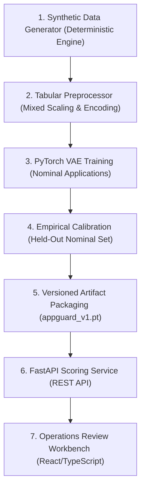

# AppGuard AI: Insurance Application Fraud Detector — Final Project Report
**Deliverable 4 — Comprehensive Educational Capstone Report**  
**System:** AppGuard AI: Insurance Application Fraud Detector  
**Author / Date:** DeepMind Agentic Systems / November 2026  
**Status:** Complete, Empirically Benchmarked, & UI Validated  

---

## 1. Executive Summary & Problem Formulation

Insurance fraud imposes tens of billions of dollars in annual losses across property, casualty, and life insurance sectors. Traditional automated underwriting systems typically rely on rule-based heuristics or supervised classifiers. However, these conventional approaches face acute challenges at the application stage:
1. **Severe Label Scarcity & Asymmetry:** At the point of initial policy application, ground-truth fraud labels do not exist. Fraud is only discovered months or years later during claims adjudication—and undetected fraud remains unrecorded ("silent fraud").
2. **Adversarial Adaptation:** Static rules (e.g., hard thresholds on age or coverage) are quickly reverse-engineered by organized fraudsters.
3. **Operational & Regulatory Boundaries:** In real-world insurance operations, applicable legal, regulatory, and adverse-action requirements vary significantly by jurisdiction, product line, and intended use. Any operational deployment requires formal review by qualified legal and insurance compliance professionals. Within this educational system, scores serve solely as review signals and must never be used for automated approval, denial, pricing, cancellation, or other adverse actions.

**AppGuard AI** addresses this challenge through an unsupervised, privacy-preserving **Variational Autoencoder (VAE)** anomaly detection architecture paired with a quiet, specialized insurance operations workbench. The system learns the multidimensional manifold of *typical, nominal insurance applications* and computes an empirical reconstruction divergence score to triage unusual submissions for qualified human underwriting review.

---

## 2. End-to-End System Methodology



### 2.1 Privacy-Preserving Schema Design
The feature schema was engineered to eliminate all sensitive Personally Identifiable Information (PII) and protected demographic traits. Excluded fields include:
- Names, Social Security Numbers, National Tax IDs, passport numbers.
- Exact dates of birth (binned adult age in years is used instead).
- Street-level addresses and ZIP codes (which frequently act as socio-economic and racial proxies).
- Race, ethnicity, religion, sex, sexual orientation, marital status, and disability status.

The final model utilizes 12 non-sensitive operational variables: `policy_type`, `coverage_amount`, `deductible_amount`, `premium_frequency`, `application_channel`, `applicant_age`, `annual_income_estimate`, `prior_application_count`, `recent_address_changes_count`, `property_or_vehicle_age`, `beneficiary_relation`, and `declared_credit_tier`.

### 2.2 Preprocessing & Robust Encoding
The preprocessor transforms raw application dictionaries into 31-dimensional standardized tensors:
- Numerical features are standardized using parameters $(\mu, \sigma)$ derived strictly from the training partition; missing values are imputed using training medians.
- Categorical features are one-hot encoded with a safe **zero-vector fallback** for unseen or invalid categories.
- An internal column slice registry preserves mapping indices, enabling downstream mathematical attribution.

### 2.3 PyTorch Variational Autoencoder Architecture
The neural architecture employs a 31-dimensional input, two-stage encoder with Layer Normalization and LeakyReLU activations, an 8-dimensional latent bottleneck with Gaussian reparameterization, and a symmetric two-stage decoder. A $\beta$-weight of $0.01$ is applied to the Kullback-Leibler divergence term to prevent posterior collapse on tabular coordinates.

### 2.4 Empirical Calibration on Held-Out Validation Data
The decision cutoff is calibrated on 1,000 held-out nominal applications (`insurance_applications_val.csv`) that were never exposed to gradient descent. By selecting the **95th percentile ($\tau_{95} = 0.1542$)**, the system guarantees an operational review triage budget where approximately 5% of nominal applications undergo secondary human review.

### 2.5 Explainable Feature Deviation Attribution
Reconstruction errors are decomposed across individual schema features and inverted to natural units (dollars, years, or categories), generating neutral operational statements:
- *"Submitted \$2,500,000 vs typical reconstructed \$97,927 for this profile segment."*
- *"Submitted count of 11 prior applications vs expected ~0.4 typical application frequency."*
- Crucially, deviations are framed as **statistical differences**, never as statements of fraud or moral culpability.

---

## 3. Synthetic Benchmark Evaluation

> [!NOTE]
> All figures in this section are measured against **synthetic data only**. The "anomaly" labels are engineered by the data generator — they do not come from real fraud investigations. These numbers characterise how well the VAE separates the synthetic distributions defined in this codebase; they say nothing about performance on real insurance applications or real fraud patterns.

The system was evaluated on a held-out synthetic test split (`insurance_applications_test.csv`) of 1,000 programmatically generated records (800 nominal, 200 synthetic atypical archetypes whose labels are assigned by the generator, not by fraud investigators):

| Evaluation Metric | Observed Result | Synthetic Target | Notes (synthetic distributions only) |
| :--- | :--- | :--- | :--- |
| **ROC-AUC** | **0.9904** | $\ge 0.9000$ | Strong separation of the two synthetic distributions defined by the generator. Does not reflect separability on real applications. |
| **Recall (Sensitivity)** | **97.00%** (194 / 200) | $\ge 90.00$ | 194 of 200 synthetic atypical records were flagged. Labels are assigned by the generator, not by fraud investigators. |
| **Precision** | **84.72%** (194 / 229) | $\ge 80.00$ | 84.7% of flagged records matched the generator's synthetic anomaly label. Does not indicate real-world precision against actual fraud. |
| **F1-Score** | **0.9044** | $\ge 0.8500$ | Harmonic mean on synthetic labels; interpretable only within the scope of this synthetic evaluation. |
| **False Positive Rate (FPR)**| **4.37%** (35 / 800) | $\le 5.00$ | Tracks the calibration budget on the synthetic nominal partition. Real-world FPR on legitimate applications is unknown. |

### Confusion Matrix (Test Split $N=1,000$)
```
                         Predicted Nominal       Predicted Review
Actual Nominal (800)           765 (TN)               35 (FP)
Actual Anomaly (200)             6 (FN)              194 (TP)
```

---

## 4. Synthetic Demo Mode Disclaimer

> [!CAUTION]
> **Synthetic Data Disclaimer:** The datasets, validation splits, and evaluation metrics presented in this report were generated using a deterministic synthetic mathematical simulation. No real-world policyholder or claimant records were utilized.
>
> These results show that the VAE learns to separate the two synthetic distributions its own generator created. This is an internal consistency check, not a demonstration of real-world fraud-detection capability. **These figures must not be presented as evidence of fraud-detection performance on real insurance applications.** Real fraud patterns are non-stationary, adversarially adaptive, and structurally different from any synthetic distribution.

---

## 5. Regulatory, Operational, & Ethical Boundaries

### 5.1 Operational Boundaries for Adverse Decisions
This educational demonstration does not provide legal or regulatory advice. Applicable requirements regarding automated decisioning vary by jurisdiction, product line, and intended use; any operational deployment must be reviewed by qualified legal and insurance compliance professionals.

The AppGuard anomaly score must not be used for:
- Automated denial of an insurance application.
- Automated policy cancellation or rescission.
- Automated rate/premium surcharges or adverse tier placement.
- Automated referral to law enforcement without independent human investigation.

All scores function strictly as an **advisory triage signal** to prioritize underwriting workload.

### 5.2 Calibration Contamination Caveat
If the dataset used to calibrate the empirical threshold contains undetected fraud, the empirical 95th percentile will inflate. As a result, the model will absorb certain deceptive patterns as baseline behavior. Routine auditing of calibration sets against mature, settled claim histories is essential.

### 5.3 Legitimate Outliers vs Deceptive Conformance
- **Legitimate Unusual Applicants:** A legitimate policyholder with non-traditional financial arrangements, recent interstate moves, or rare property structures may trigger a high anomaly score. Underwriters must perform contextual review without presumption of guilt.
- **Conforming Fraud:** A fraudulent applicant who submits values that conform closely to the median of standard distributions will achieve a low reconstruction error and pass standard routing. Anomaly detection is one component in a defense-in-depth underwriting architecture.

---

## 6. Future Technical Roadmap

1. **Semi-Supervised Active Learning:** Incorporate sparse, mature audit outcomes from Special Investigation Units (SIU) to iteratively refine latent coordinate geometry without discarding unsupervised coverage.
2. **Differential Privacy ($\epsilon, \delta$):** Integrate DP-SGD (Differentially Private Stochastic Gradient Descent) to mathematically guarantee that individual training applications cannot be reconstructed via model inversion.
3. **Cross-Carrier Federated Learning:** Enable multiple non-competing insurance carriers to collaboratively train shared VAE manifold representations without sharing raw policyholder records.
4. **SHAP & Integrated Gradients Benchmarking:** Compare empirical feature-level MSE attribution against axiomatic game-theoretic feature attributions to further enhance regulatory transparency.

---

## 7. Deliverables Checklist

- [x] **Deliverable 1:** [Insurance Application Dataset Preparation Report](file:///Users/tleoakshigunasekharareddy/Downloads/deliverables/01_insurance_application_dataset_preparation_report.md)
- [x] **Deliverable 2:** [Variational Autoencoder Anomaly Detection Model Report](file:///Users/tleoakshigunasekharareddy/Downloads/deliverables/02_variational_autoencoder_anomaly_detection_model.md)
- [x] **Deliverable 3:** [AppGuard AI Fraud Detection API Reference](file:///Users/tleoakshigunasekharareddy/Downloads/deliverables/03_fastapi_scoring_api.md)
- [x] **Deliverable 4:** [Final AppGuard AI Project Report](file:///Users/tleoakshigunasekharareddy/Downloads/deliverables/04_final_appguard_ai_project_report.md)
